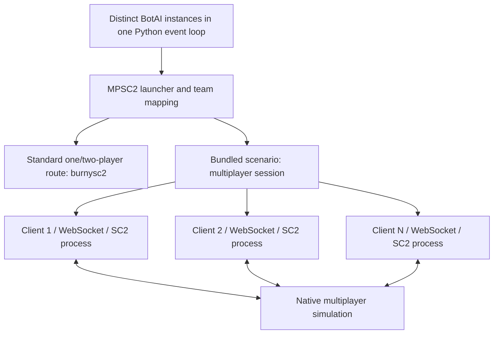

# Architecture

MPSC2 preserves the python-sc2 policy API and adds local multiplayer orchestration.

Each participant has its own SC2 process, socket, native player ID, observations
and actions. BotAI callbacks share the calling Python event loop; independent
game clients do not imply independent Python policy processes. Offload blocking
inference if it would stall other callbacks.

## Match lifecycle

1. Validate players, teams, supported options and the bundled map checksum.
2. Prepare a match-specific map with player slots, team setup and ending rules.
3. Start owned SC2 processes with separate API/network ports. Two-client
   scenarios use stock hosting. Three through eight load the native helpers.
4. Join every participant and record its actual native ID. Join order can differ
   from input order; team assignments and result lists use the recorded mapping.
5. Complete the map handshake, check ownership/alliances, and initialize BotAI.
6. Run callbacks and actions. Stepped games advance clients together; realtime
   games request observations independently and send no `Step` requests.
7. Collect native results, optionally save a replay, and release owned resources.
   An exception or cancellation propagates and also triggers cleanup.

## Native helpers

The supported engine's stock API rejects more than two independent participants.
The host-only lobby bridge completes a verified host transition, distributes
local discovery traffic, and waits for every participant's native readiness.
It changes process-local lobby data. The Windows Base93333 backend is isolated
in `windows_session.py` and `native/windows_bridge.c`; the existing macOS
Base96883 implementation retains its own helpers. Windows uses MinHook for
loopback UDP forwarding and atomically holds two unused readiness slots,
because its engine counts boolean pairs rather than summing byte values.

A separate macOS observation guard runs in every 3–8-client process. Base96883's
private opponent-upgrade lookup assumes `3-player_id`; IDs ≥4 underflow.
The guard changes seven bytes on a private executable-memory page to skip that
lookup. Public own-upgrade data and the simulation remain intact. Selected-player
replay views with IDs ≥4 use the same guard on this build.

These helpers require the exact executable hash, UUID and expected runtime
instructions. Unknown binaries are refused; the installation is unchanged.
See [MPSC2-001](known-issues.md) for the diagnosis and measured fix.

Windows Base93333 uses an exact-fault vectored exception handler for the same
invalid private upgrade lookup. It validates the executable hash, instruction
signatures, player range, index, read type, and fault address, then resumes at
the verified cleanup path. This preserves the engine's protected code mapping
and public own-upgrade data. Only the host uses the socket hook; all 3–8-client
processes and affected replay views load the observation guard.

## Maps and output

The bundled arena and economy map contain setup/alliance and native ending rules;
a renamed ladder map cannot provide those rules automatically. See
[map sources and provenance](../maps/README.md).

Each match stores a generated map, result metadata, native IDs/ports, and protocol
journals in a fresh output directory. Replays are optional. Raw run artifacts are
local outputs; public validation summaries live in `evidence/`. There is no native
process reuse, remote-client coordinator, learning algorithm or Gym/PettingZoo
adapter in this alpha.
