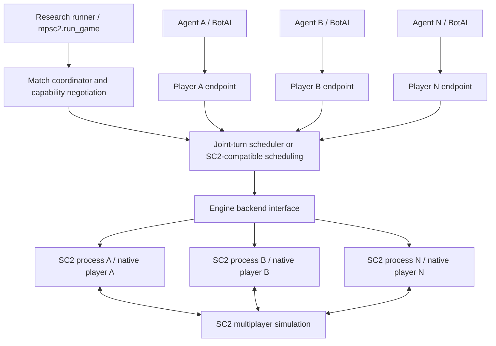

# RFC: a general multiplayer API for MPSC2

**Status: initial local implementation, 2026-11-03.** The protocol, existing-backend
wrapper, control service, SC2-compatible endpoints and joint-turn scheduler are
implemented in `mpsc2.service`. See [the service guide](../service.md) for actual
coverage and limits. The architecture below remains the design contract; stage 4
semantic discovery and the API-less-engine track remain unimplemented. No Mac
Base98310 support is claimed. The existing `run_game` path remains available.

## Decision

Build a stable multiplayer service that retains SC2's gameplay messages and
adds explicit match orchestration, teams, capability negotiation and joint
turns. Isolate engine integration behind a small backend interface. Reduce
manual binary maintenance through reusable adapter families and independently
tested discovery tools. Do not promise that a protocol definition makes every
closed-source engine version controllable.

The distinction is essential:

| Layer | Can we make it stable across SC2 updates? | Remaining dependency |
| --- | --- | --- |
| BotAI and research-agent API | Yes, for negotiated features | Catalog/enum compatibility and adapter coverage |
| Multiplayer wire protocol | Yes | A server implementing the contract |
| Scheduling, teams, recording and experiment metadata | Largely | Actual map and engine capabilities |
| SC2 memory layout, internal function signatures and bugs | Not guaranteed | A supported engine interface or validated native integration |
| Game rules and replay determinism | Not across arbitrary patches | Exact executable, data, map and seed |

The present native bridge is a small helper loaded into the real SC2 processes;
it is not a replacement game engine. The separately restored Base96883 app is
an older engine. Both differ from the proposed stable service interface.

## Why extending `sc2api.proto` alone is insufficient

Blizzard's existing protocol already expresses lists of player setups and
client ports. The current `PlayerSetup` has no team ID, and the JoinGame
definition explicitly describes a single supported client port entry.
Serialization capacity does not establish engine capacity. The local engine
tests show the runtime rejecting more than two API participants.
Adding fields to our Python messages cannot change that server-side behavior.
See the [upstream definitions][proto] and the
[existing native integration](../architecture.md).

Similarly, an independent WebSocket server can accept `CreateGame`, but must
still invoke SC2's lobby, simulation, observations and action execution.
Neither a new endpoint nor protobuf descriptors create those engine functions.
For the tested Mac Base98310, API startup failed and API-specific markers were
absent; see the [measured investigation](../macos-98310-investigation.md).
Its integration remains a separate, unresolved research problem.

## Architecture and independence



For N agent slots, the independent-client contract requires N real SC2
processes, N engine API connections and N distinct native participant IDs.
Multiple logical sockets backed by one player do not qualify. Built-in Computer
slots are separately declared and do not need their own agent process.

The service owns the SC2 processes and keeps each policy's data channel bound
to its corresponding engine client. Native ID assignment is learned at join,
never assumed from input order. A coordinator can be centralized while the
engine clients and policy perspectives remain independent. Policies may share
the current Python event loop or later run in separate workers.

Initial deployment is local to one host. The schema can address remote policy
workers, but remote exposure, distributed SC2 hosts, NAT and reconnection are
not initial implementation claims.

## Three endpoints, two gameplay modes

Use binary protobuf over WebSockets, consistent with the existing SC2
[transport and lifecycle][protocol]. Keep message formats distinct:

| Endpoint | Messages | Purpose |
| --- | --- | --- |
| `/mpsc2/v1/control` | `ControlRequest` / `ControlResponse` | Negotiate, inspect capabilities, prepare/start/inspect/close matches |
| `/mpsc2/v1/matches/{match}/players/{slot}/sc2api` | Unmodified `SC2APIProtocol.Request` / `Response` | Existing Client/BotAI gameplay calls |
| `/mpsc2/v1/matches/{match}/players/{slot}/turns` | `TurnRequest` / `TurnResponse` | Optional simultaneous-action research rounds |

The controller chooses **one gameplay mode per match**. Agents cannot mix the
two action/stepping contracts. A connection is bound to one slot and match
generation; there is no caller-selectable native player ID in a turn request.

Ordinary SC2 messages reuse the installed upstream definitions for observation,
action, data, query, replay and interface options. MPSC2 does not copy and fork
the entire SC2 protocol. The compatibility proxy forwards or translates these
messages through the backend and preserves response IDs and engine errors.

Match creation/joining belong to the control plane. The player proxy rejects
`CreateGame`, `JoinGame`, `RestartGame`, `StartReplay`, `QuickSave`, `QuickLoad`,
`Debug` and arbitrary `MapCommand` in the initial gameplay contract. `LeaveGame`
ends that participant's involvement and closes the match under the initial
disconnect policy. `Quit` cannot terminate another participant's process.
It requests closure of the caller's session involvement, with normal owned
match cleanup. A closed proxy is not proof that the engine has quit.

This preserves BotAI and Client gameplay behavior, not an unmodified
`sc2.main.run_game` launcher: MPSC2's launcher must perform the new control
handshake. Replay analysis uses a separately prepared observer session in a
later extension; the initial draft permits saving a running match's replay
through the compatible endpoint. Observer/admin views are not agent endpoints.

## Match specification and negotiation

The schema's `MatchSpec` carries:

- An explicit installation ID and optional required engine/data fingerprints.
- A registered map artifact, its SHA256 and a rules-contract identifier.
- Stable slot IDs, arbitrary signed-64-bit team labels, race, kind and interface options.
- Team vision, unit-control sharing and allied-victory policy.
- Clock mode, transport mode, seed, fixed step count and round timeout.
- Required feature names that the server must satisfy or reject.

Four agent slots can use `[0,1,2,3]` for FFA, `[0,0,0,1]` for 3v1 or
`[0,0,1,1]` for 2v2. The protocol has no built-in four- or eight-player ceiling.
The permitted count is the intersection of map slots, engine capacity,
adapter coverage and available host resources. Existing adapters still support
only their validated configurations; a larger integer in the schema grants
no additional capacity.

Team labels define a fixed partition. Allies share victory by the requested
rule; vision and unit control are separate choices. Shared vision does not
automatically grant control of an ally's units. The current map adapter may
reject rules it does not implement. A plain ladder map cannot be treated as
team-capable solely because it has enough starting locations.

When a map adapter generates a match-specific map, keep the requested source
artifact in `accepted_spec` and return the actual artifact/hash as
`materialized_map`. Record both; replay provenance uses the actual generated map.

`probe_match` is a static, read-only check. `prepare_match` launches owned
processes, obtains actual Ping identities, selects a backend and returns a
`PreparedMatch` with the accepted specification and capability evidence.
It may still fail before game creation. Required features must be known and
supported; missing/unknown features are errors, never silent approximations.
Requirements are the union of the explicit feature list and the semantics of
the specification: requesting shared vision or joint turns requires those
capabilities even if their names were omitted from the list.

Initial feature names are:

| Feature | Contract |
| --- | --- |
| `independent-clients.v1` | One native SC2 client/process/perspective per agent |
| `fixed-teams.v1` | Verified native ownership, alliance and ending rules |
| `shared-vision.v1` | Engine/map supplies the requested allied vision |
| `shared-control.v1` | Engine/map permits the requested allied unit control |
| `raw-interface.v1` | Player-scoped raw observations, actions and queries |
| `stepped-clock.v1` | All active clients advance to a common boundary |
| `realtime-clock.v1` | Engine advances without Step requests |
| `joint-turns.v1` | The buffering/barrier contract below |
| `own-upgrades.v1` | Own completed upgrades available without unsafe opponent lookup |
| `save-replay.v1` | Native replay bytes and their identities can be recorded |
| `botai-catalog.v1` | Catalog IDs required by the chosen BotAI compatibility layer are mapped |

Feature support and verification strength are distinct. Static recognition,
live probing and conformance results are recorded separately. Evidence is bound
to the executable, data selection, adapter revision, map, player count, team
rules and timing mode; a passing four-player melee test does not certify eight
players on an arbitrary map. `PrepareMatch` does not promote static checks to
successful gameplay. `StartMatch` performs the remaining roster/rule checks.

No implicit engine downgrade is permitted. If Base98310 is requested and only
Base96883 works, return `ENGINE_API_UNAVAILABLE` or `ADAPTER_UNVERIFIED` for the
requested engine. Choosing another installation requires a new explicit match
specification. The reported game/data version comes from Ping when available.

## Lifecycle and identity

1. **Hello:** negotiate a supported protocol major/minor. The first draft is 1.0.
2. **Probe:** optionally inspect a static plan for the exact requested match.
3. **Prepare:** validate artifacts, allocate owned processes/ports, probe identities,
   select a backend, reserve slots and issue separate player credentials.
4. **Start:** create and join all clients concurrently, record native IDs, establish
   map/team rules and verify observations. Publish the initial common loop L0.
5. **Run:** accept gameplay only after the match is RUNNING.
6. **End or fail:** preserve results, replay when possible, and failure context.
7. **Close:** release only match-owned processes, sockets, ports and temporary data.

`MATCH_PREPARED` is not `MATCH_RUNNING`. Initial map setup may require engine
steps; the first research epoch is 0 at the reported L0, which need not be game
loop 0. Player endpoints may be allocated during preparation but must reject
gameplay until start completes. `StartMatch` returns verified player bindings.

A generation token prevents requests from a previous match or restarted daemon
being accepted into a reused endpoint. Every agent binding must have a unique
engine instance ID and matching observed `player_common.player_id`. Process
identity checks and conformance evidence substantiate independence; assigning
unique strings in the protocol alone is insufficient.

## Joint turns for self-play

At epoch e all agents receive their own observations at the same loop L.
Each sends `SubmitTurn(e, expected_game_loop=L, actions=...)`. An explicitly
present empty action message is a no-op; an absent submission is not a no-op.

The coordinator performs these steps:

1. Validate generation, epoch, loop, slot, limits and message shape. Buffer one
   immutable submission per active agent. Reply `TurnAccepted` immediately.
2. Wait for all submissions, including explicit no-ops. Do not dispatch an early
   agent's actions while another agent is still choosing.
3. Dispatch every buffered action batch to its respective SC2 client. Collect
   actual `ResponseAction` values. Buffer acknowledgment is not engine acceptance.
4. Issue equal Step counts to all native clients concurrently, exactly once for
   this round. Do not also call the existing session's Step from the proxy.
5. Collect each client's observation. Verify the common resulting game loop and
   native player binding, then publish the per-player `TurnResult` for epoch e.

For a nonterminal round the resulting loop must equal L plus the negotiated
step count. Terminal observations are asynchronous completion records, not a new decision
boundary. Live testing found that SC2 keeps advancing some clients while
GameOver propagates: final frames differed by one in a four-player game and by
two in an eight-player game. All clients must have native `ended` status and
agree on the complete terminal result table. Their final frames must not move
backwards. Terminal observations retain their actual per-player loop numbers;
`MatchSnapshot.game_loop` is absent when they differ. There is no claim that
terminal frame spread or advancement obeys the active-round Step bound. No next
decision round follows a terminal result. Nonterminal divergence still
fails/truncates. This refines the original proposal's strict final-boundary
assumption based on measured engine behavior.

Agents fetch results with `AwaitTurn(e)`; this split avoids a blocking submit
deadlocking sequential policy orchestration. The MPSC2 Python launcher can
submit for every policy, then await all results. Query, Data, GameInfo and Ping
reuse upstream messages via `TurnRequest.read`. Observation reads expose only
the last committed per-player snapshot. Gameplay reads during dispatch/step
are queued until the next committed boundary, so a late reader cannot observe
half-completed round effects. Mutation requests inside `read` are rejected.

This guarantees a common decision boundary and all-actions-before-advance;
it does **not** guarantee atomic execution or rollback inside SC2. If one client
accepts actions and another fails, mark the match FAILED with
`PARTIAL_DISPATCH`/`UNCERTAIN_EXECUTION`, truncate the episode and clean up.
Do not retry the action batch on the surviving clients or report a valid round.

Duplicate SubmitTurn requests for the same generation/epoch and semantically
identical actions return the previous receipt/result. Different actions for an
already submitted epoch produce `ROUND_CONFLICT`. Compare parsed normalized
fields, not arbitrary protobuf byte encodings. Completed results are cached
through the match lease. Following daemon failure, resume of an in-flight
round is unsupported; a new match gets a new generation. This is bounded
idempotency, not a claim of distributed exactly-once execution.

The initial timeout/disconnect policy aborts and truncates the entire match.
It never silently supplies an agent's missing action, skips a player or treats
a crashed participant as a legitimate competitive defeat. Other policies may
be added only as explicit negotiated experiment rules.

## SC2-compatible stepping and realtime

Existing BotAI code frequently waits for `ResponseAction` before sending Step.
Consequently the compatibility endpoint forwards actions and returns their
actual engine acknowledgments immediately. It cannot invisibly buffer those
acknowledgments until every agent submits a Step: that can deadlock existing
code. Instead the proxy intercepts each Step as a readiness vote and advances
all native clients once, after all votes agree on the negotiated step count.
This mode has a weaker simultaneous-action contract than joint turns.
In stepped mode, an Observation request for a future loop is rejected rather
than allowed to block its own agent from voting to advance. Ordinary current-loop
observations remain supported.

Realtime uses ordinary SC2-compatible requests. Step is rejected. Observations
retain their actual loop numbers and may differ among agents; neither a shared
wall-clock timestamp nor batching makes them simultaneous. Actions are forwarded
as received with bounded queues, and receive/dispatch times are logged. Joint
turn mode combined with realtime is rejected in this first revision.

## Player information, catalogs and experimental results

Observations, queries and actions always originate from the player's own
engine connection. Do not construct player observations by filtering a single
omniscient snapshot: fog state, snapshots, cloaking, upgrades, selection and
query results have richer visibility rules than an owner-ID filter. Shared
vision is supplied by the native alliance/map rules. The
[raw protocol][raw] makes these distinctions explicit.

Unit tags are scoped to a match generation and player's permitted commands;
they are not global entity identifiers. The proxy does not synthesize enemy
upgrades. Privileged debug/observer state is a separate capability and credential,
never part of a default policy connection. Backend action validation remains
authoritative for legality and resources.

The general interface exposes the actual runtime data catalog and numeric wire
IDs. A separate BotAI adapter maps legacy IDs when a verified semantic match
exists. Names alone are not sufficient: mappings must check relevant metadata,
remaps, collisions and action round trips. Unmapped new units/abilities remain
usable by catalog-aware agents, but cannot automatically be represented by
every fixed upstream Python Enum. Full BotAI compatibility is therefore a
negotiated capability, not an automatic consequence of matching protobuf types.
Apply ID translation in exactly one layer: initially the MPSC2 Python client,
reusing the existing `ProfileClient` approach. The service forwards native wire
IDs, preventing accidental translation twice.

Record executable/data/map/adapter fingerprints, seed, requested and actual
player mappings, initial loop, action results, timing and replay hash. Normalize
team labels without discarding the user's original labels. The first API carries
native per-player outcomes and explicit terminated/truncated flags; research
reward shaping belongs in a separately versioned experiment wrapper. A 2v2
win/loss game is competitive between teams and cooperative within each team;
the wire protocol should not assume individual zero-sum rewards. A timeout
is not a native tie. Cross-patch replay equivalence is not promised.

## Backend interface and reducing version-specific work

Keep the internal interface small; it can be in-process Python initially:

```text
probe(spec) -> capability report
prepare(spec) -> owned clients, engine identity, supported feature plan
create_and_join(spec) -> native player bindings
configure_rules(bindings, team_rules) -> verified initial observations
observe(player) / act(player, actions) / query(player, query) / data(player)
advance_all(count) -> verified common game loop
save_replay() -> bytes and provenance
close() -> owned-resource cleanup report
```

| Backend | Role | What it can generalize |
| --- | --- | --- |
| Stock SC2 API | Preferred whenever requested capabilities actually work | Common gameplay messages; future engines with native multiplayer support need no bridge |
| Existing native adapters | Wrap today's validated Mac/Windows/Linux implementation | One protocol and lifecycle across the current supported builds |
| Discovered native adapter | Research branch using semantic discovery and conformance | Reduce manual address updates across similar implementation families |
| New engine-side API implementation | Separate research effort when stock API is absent | Must implement real observations/actions/lobby/timing; still needs an integration surface |

For discovered adapters, move from manually entered addresses to a pipeline:

1. Identify executable format, architecture, OS ABI and available API descriptors.
2. Locate candidate lobby/ready/observation routines using multiple anchors,
   instruction/data-flow structure, cross-references and object-layout evidence.
3. Require a unique candidate and compatible calling convention. A matching
   error string or byte pattern alone is insufficient.
4. In disposable owned processes, verify lobby-state transitions, slot counts,
   readiness progression, distinct native IDs and normal observation behavior.
5. Apply only the validated operation in that isolated test; run the conformance
   matrix below. Ambiguity or failure stops discovery and preserves diagnostics.
6. Cache a receipt keyed by exact executable/data/adapter identity. Reuse a
   resolver across a compatible family, but invalidate receipts on changes.

This reduces hand-maintained offsets; it does not eliminate binary dependence.
Compiler changes, anti-tamper behavior, changed semantics and missing functions
can break discovery. No generic resolver is currently implemented. Existing
hash/UUID/instruction guards remain until a replacement meets these gates.
Unknown executables must not be enabled just by deleting the current hash check.

A truly durable engine backend requires a stable extension interface maintained
by the engine vendor, or an engine implementation we control. SC2's published
client libraries implement the client side of its API; they are not source code
for the game server. An injected replacement API on Base98310 would need to
recover all necessary internal hooks and construct correct observations and
queries, not merely define new protobuf fields. That is substantially larger
than adapting the existing lobby bridge.

Map scripting is useful for team/scenario rules. It is not an established
substitute for the external agent transport: `RequestMapCommand` itself uses
SC2's API. A bank/file mailbox or other map-only transport would first need
proof of bidirectional communication, synchronization, fog-correct data,
ordinary commands and all independent clients on an unmodified build. It
should not be advertised as a universal backend before those tests pass.

## Wire rules and service boundaries

- Proto2 fields are syntactically optional for evolution; the contract still
  requires presence of IDs, generation, specification fields and operation.
  Unknown/zero enum values are rejected where a choice is mandatory.
- Mandatory MatchSpec fields are engine installation ID; map ID/hash/rules
  contract; nonempty unique slots with team/kind/race; all three team-rule
  values; clock; transport; and seed. Every agent requests raw interface options.
  Stepped mode also requires positive step count; joint turns require a positive
  round timeout. Unsupported player kinds, sharing options or counts are errors.
- Control requests have unique nonempty IDs. Retrying a state-changing control
  request with the same ID and identical parsed content returns its recorded
  outcome within the lease; different content is REQUEST_CONFLICT. Do not execute a
  second Prepare/Start after a lost response. Requests outside the retained lease
  cannot claim retry safety. An in-progress operation is awaited, not duplicated.
- Start failure closes all owned clients. Close is idempotent and preserves the
  terminal result record. Prepare leases reclaim abandoned resources. GetMatch
  returns status without exposing player credentials again.
- Bind localhost by default. Authenticate controller and each player separately;
  return player tokens only to the controller over the authenticated channel.
  One active writer per slot; v1 disconnect ends a running match. Keep tokens out
  of URLs, replays and logs. Remote access requires a separately implemented
  authenticated encrypted deployment, not just changing the bind address.
- Register maps locally before preparation; accept artifact IDs/hashes, not
  arbitrary client-supplied server filesystem paths. Map-upload and installation
  management are outside this draft.
- Negotiate frame limits; bound concurrent requests, memory and action queues.
  Joint mode allows only one uncompleted round submission per slot. Large replay
  transfer needs an explicit size limit or later artifact-transfer extension.
- Additive fields keep their tags; removed tags/names are reserved. Unknown
  operations return UNSUPPORTED_MESSAGE. New mandatory semantics require a
  negotiated capability or protocol major; older peers must not silently ignore
  required team/clock behavior. Follow [Protobuf evolution guidance][protobuf].

## Migration and acceptance gates

| Stage | Deliverable | Acceptance gate |
| --- | --- | --- |
| 0 | RFC, schema and example messages | Schema compiles against installed upstream descriptors; examples round-trip; no gameplay claim |
| 1 | Internal backend interface wrapping the current sessions | Existing BotAI tests and live 2–8-client regressions unchanged |
| 2 | Local control service and SC2-compatible per-player proxies | Independent process/ID proof; team/fog tests; no double stepping; cancellation and port cleanup |
| 3 | Joint-turn scheduler and research client | No early dispatch, duplicate/conflicting/stale turns, timeout and partial-dispatch tests; real engine loop synchronization |
| 4 | Semantic resolver for one known adapter family | Correct discovery on held-out builds, deliberate mismatch rejection and complete gameplay conformance |
| Separate feasibility track | Engine-side interface for API-less builds such as the tested Base98310 | Ping, raw observation and a normal command on one real client before any multiplayer-support claim |

The intended Python migration keeps `mpsc2.run_game(..., team_ids=...)` and
existing BotAI callbacks. Service discovery and compatibility proxies go inside
MPSC2's launcher. Joint-turn research code can opt into the new transport;
it is not silently substituted for old action timing. The service is opt-in through `mpsc2.service`; `run_game` does not yet use it
internally, and no Python `backend=` parameter is added.

Engine conformance must cover every advertised count (currently 2–8), FFA,
3v1/2v2 and other supported partitions, randomized join order, own/ally/enemy
visibility, ordinary mining/building/training, all races, upgrades, combat,
victory/results, stepped and realtime modes, replay saving/playback, and owned
resource cleanup. For generic discovery, include negative tests against ambiguous
layouts and the known API-less candidate. Mock protocol tests cannot certify
engine support. Keep compatibility, protocol version and gameplay reproducibility
as three separate reported facts.

The practical recommendation is to implement stages 1–3 first: they provide a
general user-facing API immediately while preserving the working research
system. Stage 4 reduces recurring porting effort. The API-less engine track has
an independent feasibility gate and should not block a useful stable protocol.

[proto]: https://github.com/Blizzard/s2client-proto/blob/master/s2clientprotocol/sc2api.proto
[protocol]: https://github.com/Blizzard/s2client-proto/blob/master/docs/protocol.md
[raw]: https://github.com/Blizzard/s2client-proto/blob/master/s2clientprotocol/raw.proto
[protobuf]: https://protobuf.dev/programming-guides/proto2/
